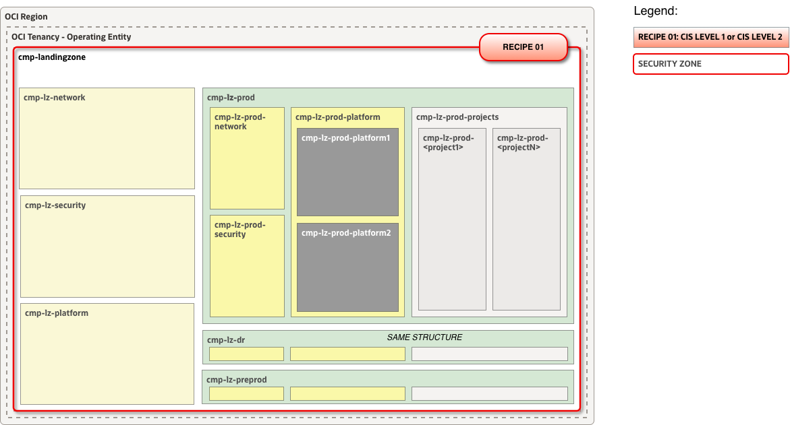

## **[Security Zone Recipes for CIS Level 2](#)**
### Overview
The One-OE Landing Zone implements a subset of the **CIS Level 2** controls through a set of layered Security Zone recipes. Each recipe builds upon the controls defined in the previous recipe and introduces additional security restrictions.

This document describes the Security Zone recipes defined in the [oneoe_security_cis2_pre.json](oneoe_security_cis2_pre.json) and [oneoe_security_cis2.json](oneoe_security_cis2.json) files and their assignment across the One-OE Landing Zone compartment hierarchy.

&nbsp;
#### [Security Zone](https://docs.oracle.com/en-us/iaas/Content/security-zone/using/security-zones.htm) and [Recipe](https://docs.oracle.com/en-us/iaas/Content/security-zone/using/managing-recipes.htm) assignment across the [One-OE](https://github.com/oci-landing-zones/oci-landing-zone-operating-entities/tree/master/blueprints/one-oe) Landing Zone compartment hierarchy

&nbsp;

> [!IMPORTANT]
> - These Security Zone recipes provide a minimum baseline of security controls for **CIS Level 2** environments. Additional Security Zone policies and controls should be implemented to align with organizational security requirements, compliance obligations, and risk tolerance.
>
> - Security Zone policies are enforced based on the recipe assigned to the Security Zone associated with a compartment. When a child compartment is assigned a different Security Zone, only the policies defined in that Security Zone's recipe are enforced for resources within the child compartment.

&nbsp;
&nbsp;

#### Reference:
- [Oracle Cloud Infrastructure Documentation - Security Zone Policies](https://docs.oracle.com/en-us/iaas/Content/security-zone/using/security-zone-policies.htm)

&nbsp;

# License 

Copyright (c) 2026 Oracle and/or its affiliates.

Licensed under the Universal Permissive License (UPL), Version 1.0.

See [LICENSE](/LICENSE.txt) for more details.
